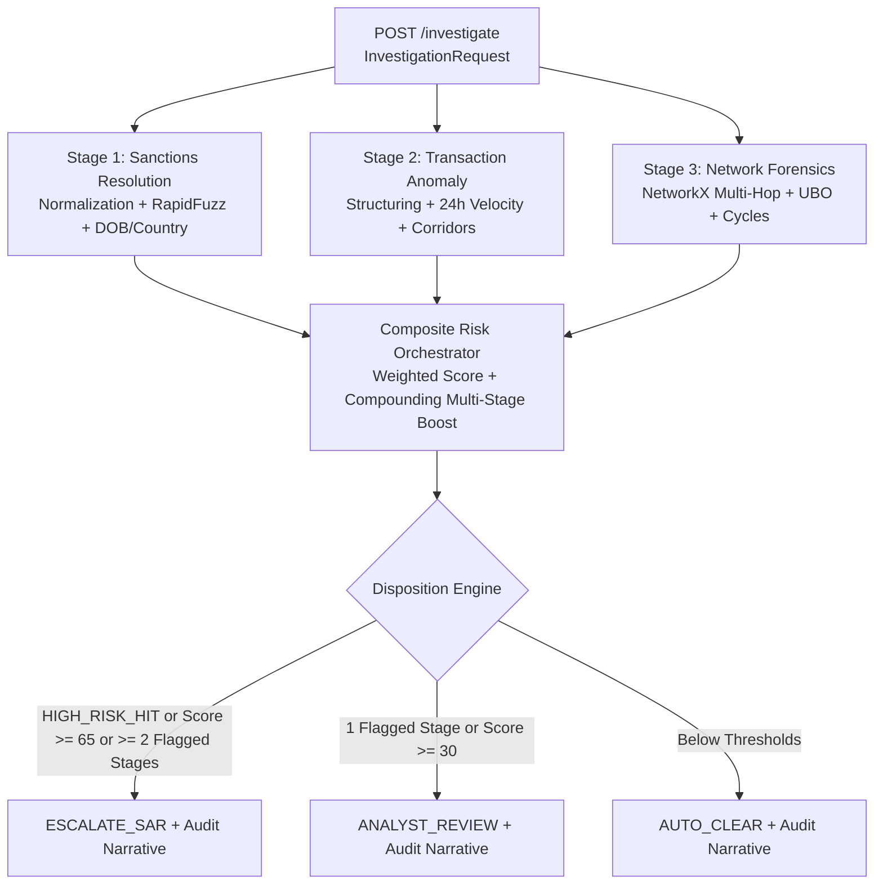

# End-to-End AML Investigation Pipeline

[](https://github.com/oscartandi/aml-investigation-pipeline/actions/workflows/ci.yml)


A unified financial crime investigation engine that orchestrates **Sanctions Entity Resolution**, **Real-Time Transaction Anomaly Detection**, and **Multi-Hop Graph Forensics** into a single auditable disposition (`ESCALATE_SAR`, `ANALYST_REVIEW`, or `AUTO_CLEAR`).

---

## Architecture & Investigation Flow


Quickstart & Local Setup

1. Clone & Install Dependencies

Bash
```
git clone [https://github.com/oscartandi/aml-investigation-pipeline.git](https://github.com/oscartandi/aml-investigation-pipeline.git)
cd aml-investigation-pipeline
python -m venv .venv
# Windows
.venv\Scripts\activate
# macOS / Linux
source .venv/bin/activate

pip install -r requirements.txt

```
2. Launch the Investigation Server & UI Workbench
Start the FastAPI backend and interactive workbench using Uvicorn:

Bash

```
uvicorn app.main:app --reload
```

Once running, open your browser to:

```
AML Investigation Workbench (UI): http://127.0.0.1:8000/

Interactive Swagger API Docs: http://127.0.0.1:8000/docs

Health Check Endpoint: http://127.0.0.1:8000/health
```
Using the AML Investigation Workbench 

```
Open http://127.0.0.1:8000/ in your browser.   
```

Select one of the built-in Test Scenarios (or paste a custom JSON payload into the Case Payload editor):
```
Clean Name + Hidden UBO & Cycle: Tests multi-hop graph detection and circular money laundering flows (ESCALATE_SAR).   

Exact Sanctions Alias Hit: Validates fuzzy matching and watchlist resolution.   

DOB Conflict False-Positive Check: Verifies false-positive suppression on name collisions.   

Benign Customer (Auto-Clear): Confirms low-risk baseline scoring (AUTO_CLEAR).   
```
Click Run End-to-End Investigation to inspect the composite risk score, stage-by-stage findings, automated SAR/audit narrative, and entity link topology.   

API Usage Example

Send a POST request directly to /investigate:  

Bash

```
curl -X POST "[http://127.0.0.1:8000/investigate](http://127.0.0.1:8000/investigate)" \
  -H "Content-Type: application/json" \
  -d '{
    "case_id": "CASE-104",
    "entity": {
      "entity_id": "ENT-CLEAN-99",
      "name": "Bluewater Horizon Exports Pvt Ltd",
      "entity_type": "CORPORATE",
      "country": "SG"
    },
    "transaction": {
      "amount_usd": 9400,
      "tx_count_24h": 5,
      "total_volume_24h": 47000,
      "counterparty_country": "AE"
    },
    "network_edges": [
      {"source": "ENT-CLEAN-99", "target": "SHELL-77", "relation": "BENEFICIAL_OWNER", "weight": 1},
      {"source": "SHELL-77", "target": "MULE-55", "relation": "TRANSFER", "weight": 1},
      {"source": "MULE-55", "target": "ENT-CLEAN-99", "relation": "TRANSFER", "weight": 1}
    ],
    "known_high_risk_nodes": ["SHELL-77"]
  }'
Running Tests
```

Execute the automated pytest suite to verify all three investigation stages and composite scoring thresholds:   

Bash
```
pytest -v
```
